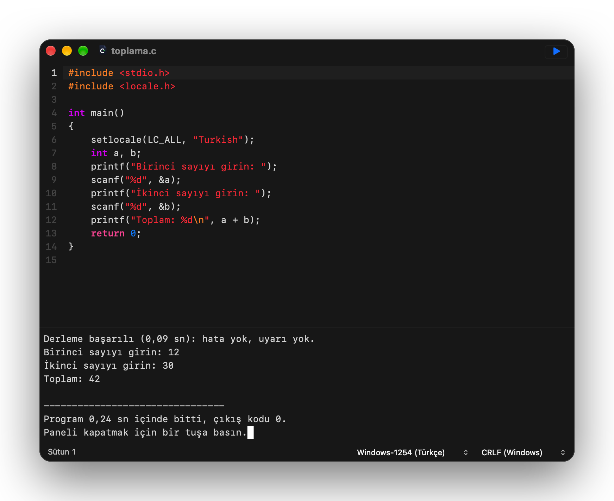
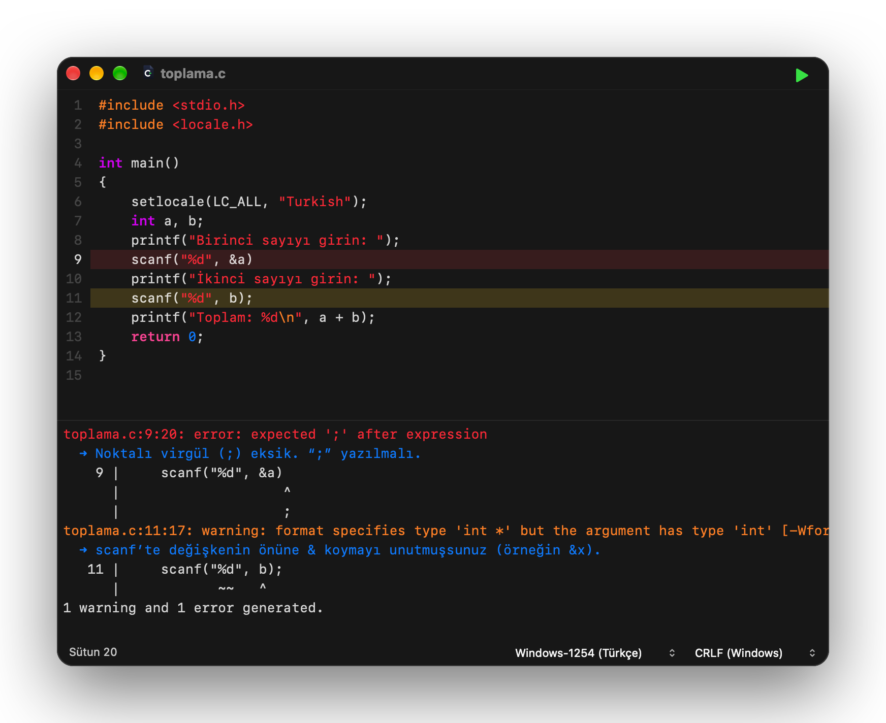

<div align="center">
  
  <h1>C Editor</h1>
  <p><strong>Mac için sade ve hızlı C editörü. Kodunu yaz, ⌘R’ye bas, çalışsın.</strong></p>
  <p>Sürüm 0.3 · macOS 27 · Apple silicon</p>

  [](https://github.com/erhansavas/c-editor/releases)
  [](LICENSE)
</div>

<p align="center">
  
</p>

C Editor, C öğrenenler için yapıldı. Kurulacak ya da ayarlanacak bir şey yok: bir dosya açın veya yazmaya
başlayın, **⌘R**’ye basın; programınız kodun altındaki konsolda çalışsın. Okuldaki Windows bilgisayarlarda yazılan
kod da Türkçe karakterleriyle birlikte olduğu gibi çalışır.

## Özellikler

- **Hızlı ve sade bir editör:** sözdizimi renklendirme, sekmeler (**⌘1**…**⌘8** ile sekme seçilir, **⌘9** son
  sekme, **⌘⇧T** kapatılan sekmeyi yeniden açar), trackpad ile yakınlaştırma.
- **Yazarken düzen, ama dokunmadan:** `{` ile ya da süslü parantezsiz `if (...)`, `else`, `for (...)`,
  `while (...)`, `do` ile biten satırdan sonra yeni satır bir kademe içeriden başlar; o tek komutun ardından
  geri döner. Boş satıra yazılan `}` kendi `{` satırıyla, `{` ise üstündeki `if`/`else` ile hizalanır. Soluk
  dikey çizgiler girinti düzeylerini gösterir; metin içindeki kaçış dizileri (`\n`, `\t`, `\"`, `\\`) ayrı
  renktedir. Yazdığınız başka hiçbir şey değiştirilmez, hiçbir şey önerilmez. `\` ile biten bir `//` yorumu,
  C’de olduğu gibi alt satırı da yoruma katar; editör o satırı da yorum renginde gösterir.
- **Tek tuşla derle ve çalıştır:** **⌘R**, **F11** ya da ▶︎ düğmesi. Hatalar editörün altında listelenir ve
  satırlarında işaretlenir; birine tıklayınca o satıra gidilir.
- **Hatalarda Türkçe yardım:** sık yapılan hatalar Türkçe açıklanır: eksik noktalı virgül, scanf’te unutulan &,
  koşulda == yerine =, tanımsız değişken… Derleyici düzeltmeden eminse açıklama satırın tam olarak ne
  olması gerektiğini söyler; düzeltmeyi siz yaparsınız, editör sizin yerinize yazmaz. [Örneğe bakın](#hata-yapınca).
- **Anlaşılır mesajlar:** “Derleme başarılı (0,08 sn): hata yok, uyarı yok.” Program bitince çıkış kodunu,
  çökerse nedenini söyler; örneğin izin verilmeyen bir bellek alanına eriştiğini.
- **Kodun altında bir konsol:** program pencerenin altındaki panelde çalışır; panel çıktı arttıkça 80×25’e
  kadar büyür. Program sorduğunda panele tıklayıp girdiyi yazarsınız. **Ctrl+C** programı durdurur; program
  bitince herhangi bir tuş paneli kapatır; `\a` yüksek sesli bir uyarı sesi çalar. Pencereyi kapatmak, sonsuz
  döngüye girmiş bir programı bile sonlandırır.
- **Her yerde Türkçe:** Türkçe karakterler editörde, konsolda ve dosyalarda doğru görünür. Dosyalar UTF-8 ya da
  Windows-1254 (Türkçe) olarak açılır ve kendi biçimlerinde kaydedilir. Yeni dosyalar Windows’un kaydettiği
  biçimdedir (Windows-1254, CRLF); böylece okuldaki bilgisayarlarda da düzgün açılır. İkisi de durum
  çubuğundan değiştirilebilir.
- **Windows’ta yazılan kod olduğu gibi çalışır:** [ayrıntılar aşağıda](#windowstan-gelen-kod).

## Örnek

```c
#include <stdio.h>
#include <locale.h>

int main()
{
    setlocale(LC_ALL, "Turkish");
    int a, b;
    printf("Birinci sayıyı girin: ");
    scanf("%d", &a);
    printf("İkinci sayıyı girin: ");
    scanf("%d", &b);
    printf("Toplam: %d\n", a + b);
    return 0;
}
```

**⌘R**’ye basın, iki sayı yazın; konsolda şunu görürsünüz:

```text
Derleme başarılı (0,10 sn): hata yok, uyarı yok.
Birinci sayıyı girin: 12
İkinci sayıyı girin: 30
Toplam: 42

--------------------------------
Program 0,27 sn içinde bitti, çıkış kodu 0.
Paneli kapatmak için bir tuşa basın.
```

## Hata yapınca

Aynı programda iki tipik hata: bir satırda noktalı virgül unutulmuş, diğerinde scanf’te `&` eksik. Hatalı
satırlar işaretlenir ve imleç ilk hataya gider; editörün altındaki listede her mesajın altında Türkçe
açıklaması çıkar, örneğin “Noktalı virgül (;) eksik. “;” yazılmalı.” Bir mesaja ya da açıklamasına tıklayınca
o yere gidilir.

<p align="center">
  
</p>

## Windows’tan gelen kod

| Kodunuzda | C Editor’de |
| --- | --- |
| `system("pause")` | “Devam etmek için bir tuşa basın . . .” yazar ve bir tuş bekler |
| `system("cls")` | konsolu temizler |
| `system("chcp 1254")`, `color`, `title`, `mode` | sorun çıkarmaz; Mac’te gerekmez |
| `setlocale(LC_ALL, "Turkish")` | Türkçe yerel ayar |
| `fflush(stdin)` | yazılan satırın kalanını atar, Windows’taki gibi |
| `<conio.h>`: `getch`, `getche` | tek tuş okur |
| `<windows.h>`: `Sleep`, `SetConsoleOutputCP`, `SetConsoleCP` | desteklenir |
| `#include <bits/stdc++.h>` | desteklenir |
| `int` yazılmamış `main()`, unutulmuş `#include` | Windows’taki GCC gibi hata değil, uyarı verir |

## Kurulum

1. [Sürümler](https://github.com/erhansavas/c-editor/releases) sayfasından `C-Editor-0.3-macOS-arm64.dmg`
   dosyasını indirin.
2. Açın ve **C Editor**’ü **Applications** (Uygulamalar) klasörüne sürükleyin.
3. Uygulama Apple onaylı (notarize) olmadığı için macOS ilk açılışı engeller: **Sistem Ayarları › Gizlilik ve
   Güvenlik**’e gidip **Yine de Aç**’ı seçin.
4. Programları derlemek için Apple’ın ücretsiz Komut Satırı Araçları gerekir. Kurulu değilse ⌘R’ye ilk
   bastığınızda C Editor bunu söyler; **Kur**’a tıklamanız yeterli, Apple’ın kurulumu açılır.

İndirdiğiniz dosyayı doğrulamak için: `shasum -a 256 -c C-Editor-0.3-macOS-arm64.dmg.sha256`

## Kaynaktan derleme

Apple silicon, macOS 27 ve Xcode 27 gerekir.

```sh
./build.sh              # bu Mac için uygulama: build/release/
./build.sh debug        # ASan/UBSan ile uygulama: build/debug/
./build.sh test         # ASan/UBSan altında testler
./build.sh dist         # tüm Apple silicon Mac’ler için DMG ve SHA-256: build/dist/
./build.sh --install    # uygulamayı /Applications klasörüne kurar
```

## Lisans

Apache License 2.0. Bkz. [LICENSE](LICENSE).
