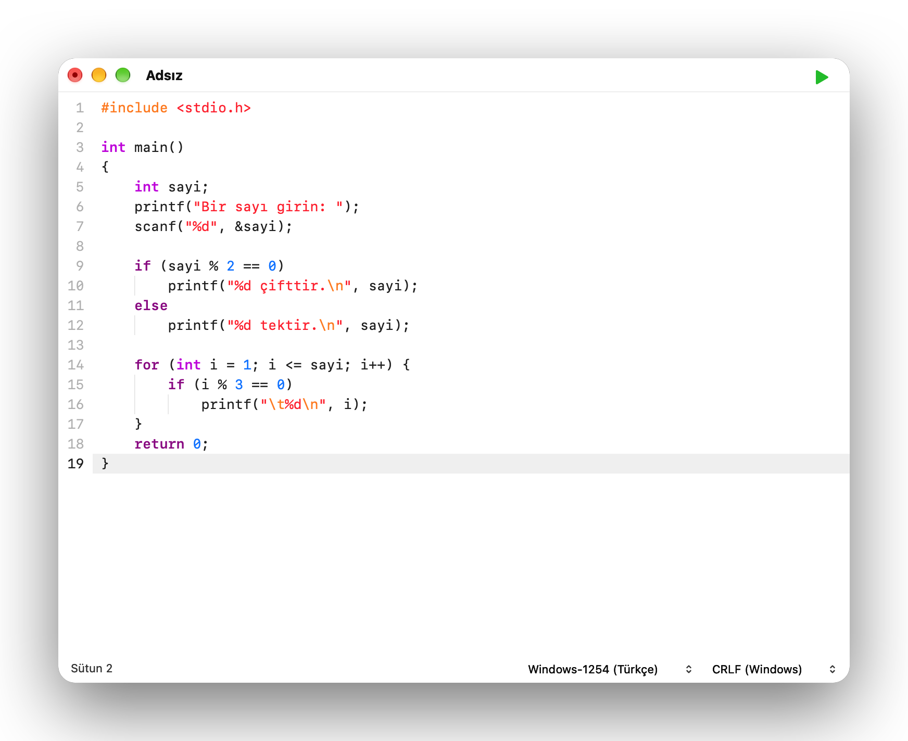
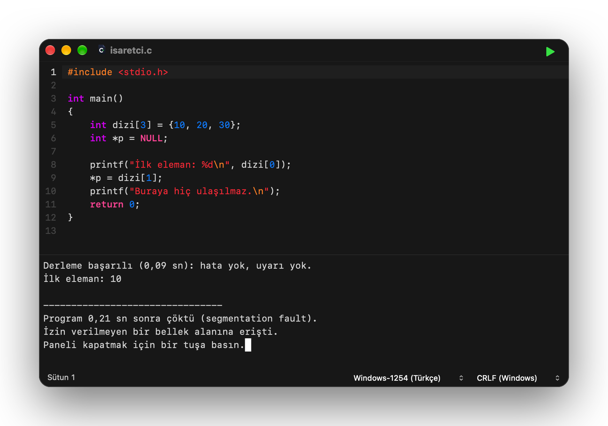

<div align="center">
  
  <h1>C Editor</h1>
  <p><strong>Mac için sade ve hızlı C editörü. Kodunu yaz, ⌘R’ye bas, çalışsın.</strong></p>
  <p>Sürüm 0.4 · macOS 27 · Apple silicon</p>

  [](https://github.com/erhansavas/c-editor/releases)
  [](LICENSE)
</div>

<p align="center">
  
</p>

C Editor, C öğrenenler için yapıldı. Kurulacak ya da ayarlanacak bir şey yok: bir dosya açın veya yazmaya
başlayın, **⌘R**’ye basın; programınız kodun altındaki konsolda çalışsın. Okuldaki Windows bilgisayarlarda
yazılan kod da Türkçe karakterleriyle birlikte olduğu gibi çalışır.

C Editor öğretir, sizin yerinize yazmaz: kod tamamlama, yazarken öneri ya da tek tıkla düzeltme yoktur. Hata
yaptığınızda nerede olduğunu ve satırın ne olması gerektiğini söyler; düzeltmeyi siz yaparsınız.

## Neler yapar

- **Tek tuşla derle ve çalıştır:** **⌘R**, **F11** ya da sağ üstteki yeşil ▶. Program kodun altındaki konsolda
  çalışır; sorduğunda girdiyi oraya yazarsınız.
- **Yazarken düzen, ama dokunmadan:** girinti kendiliğinden gelir, soluk çizgiler blokları gösterir.
- **Hatalarda Türkçe yardım:** sık yapılan hataların altında ne olduğu ve ne yazılması gerektiği.
- **Çökmelerde neden:** program çökerse nedenini Türkçe söyler.
- **Windows’ta yazılan kod olduğu gibi çalışır:** `system("pause")`, `getch()`, Türkçe karakterler, Windows-1254.
- **Hızlı ve sade:** Apple silicon için yerel bir uygulama; sözdizimi renklendirme, sekmeler, yakınlaştırma.

## Yaz, ⌘R’ye bas

Yukarıdaki program üç not okur, her birini değerlendirir ve sınıf ortalamasını yazar. **⌘R**’ye basınca derlenir
ve konsolda çalışır; notları konsola yazarsınız. `setlocale(LC_ALL, "Turkish")` sayesinde ortalama Türkçe
biçimde, virgülle çıkar: `66,7`. Metinlerdeki `\t` ve `\n` gibi kaçış dizileri ayrı renkte görünür; ne işe
yaradıkları konsolda hemen görülür.

Derleme ve program bitince tek satırlık özetler gelir: “Derleme başarılı (0,12 sn): hata yok, uyarı yok.”,
“Program 0,27 sn içinde bitti, çıkış kodu 0.” Program bitince herhangi bir tuş konsolu kapatır; çalışırken
**Ctrl+C** durdurur. `\a` yüksek sesli bir uyarı sesi çalar. Pencereyi kapatmak sonsuz döngüye girmiş bir
programı bile sonlandırır.

## Yazarken düzen, ama dokunmadan

<p align="center">
  
</p>

Bu kodda tek bir girinti boşluğu elle yazılmadı; her satırdan sonra yalnızca Enter’a basıldı:

- `{` ile ya da süslü parantezsiz `if (...)`, `else`, `for (...)`, `while (...)`, `do` ile biten satırdan sonra
  yeni satır bir kademe içeriden başlar; o tek komutun ardından geri döner.
- Boş satıra yazılan `}` kendi `{` satırıyla, `{` ise üstündeki `if`/`else` ile hizalanır.
- Soluk dikey çizgiler hangi satırın hangi bloğa ait olduğunu gösterir.

Yazdığınız başka hiçbir şey değiştirilmez, hiçbir şey önerilmez. `\` ile biten bir `//` yorumu, C’de olduğu
gibi alt satırı da yoruma katar; editör o satırı da yorum renginde gösterir.

## Hata yapınca

<p align="center">
  
</p>

Aynı türden bir programda iki tipik hata: bir satırda noktalı virgül unutulmuş, diğerinde scanf’te `&` eksik.
Hatalı satırlar işaretlenir ve imleç ilk hataya gider. Derleyicinin mesajları İngilizce kalır, terimleri
tanıyın diye; her birinin altında Türkçe açıklaması çıkar: “Noktalı virgül (;) eksik. “;” yazılmalı.” Bir
mesaja ya da açıklamasına tıklayınca o yere gidilir; düzeltmeyi siz yazarsınız.

Türkçe açıklanan başka hatalar: tanımsız değişken ve doğrusu, koşulda `==` yerine `=`, `if (...);` gibi boş
gövdeli koşul ve döngüler, printf/scanf’te tutmayan `%d`’ler, kapanmamış tırnak ve parantezler, eksik `}`,
ilk değeri verilmemiş değişken, `#include` unutulmuş fonksiyonlar ve daha fazlası.

## Program çökünce

<p align="center">
  
</p>

Program derlendi ama çalışırken çöktü: NULL bir işaretçiye yazmaya çalıştı. C Editor ne olduğunu İngilizce
adıyla (segmentation fault) ve Türkçe nedeniyle söyler. Aritmetik hatalar, `abort()` ve Ctrl+C ile durdurma da
böyle açıklanır.

## Windows’tan gelen kod

| Kodunuzda | C Editor’de |
| --- | --- |
| `system("pause")` | “Devam etmek için bir tuşa basın . . .” yazar ve bir tuş bekler |
| `system("cls")` | konsolu temizler |
| `system("chcp 1254")`, `color`, `title`, `mode` | sorun çıkarmaz; Mac’te gerekmez |
| `setlocale(LC_ALL, "Turkish")` | Türkçe yerel ayar |
| `fflush(stdin)` | yazılan satırın kalanını atar, Windows’taki gibi |
| `<conio.h>`: `getch`, `getche` | tek tuş okur |
| `<windows.h>`: `Sleep`, `SetConsoleOutputCP`, `SetConsoleCP` | desteklenir |
| `#include <bits/stdc++.h>` | desteklenir |
| `int` yazılmamış `main()`, unutulmuş `#include` | Windows’taki GCC gibi hata değil, uyarı verir |

## Türkçe ve dosya biçimleri

Türkçe karakterler editörde, konsolda ve dosyalarda doğru görünür. Dosyalar UTF-8 ya da Windows-1254 (Türkçe)
olarak açılır ve kendi biçimlerinde kaydedilir. Yeni dosyalar Windows’un kaydettiği biçimdedir (Windows-1254,
CRLF); böylece okuldaki bilgisayarlarda da düzgün açılır. İkisi de durum çubuğundan değiştirilebilir.

## Kısayollar

| Kısayol | İş |
| --- | --- |
| **⌘R** ya da **F11** | Derle ve çalıştır |
| **⌘N** / **⌘T** / **⌘O** | Yeni dosya / yeni sekme / aç (sekmede) |
| **⌘S** / **⌥⌘S** | Kaydet / farklı kaydet |
| **⌘W** / **⌘⇧T** | Sekmeyi kapat / kapatılan sekmeyi yeniden aç |
| **⌃⇥** / **⌃⇧⇥** | Sonraki / önceki sekme |
| **⌘1**…**⌘8** / **⌘9** | O sekmeye git / son sekmeye git |
| **Ctrl+C** | Çalışan programı durdur |
| Trackpad ile kıstırma | Yakınlaştır, uzaklaştır |

## Kurulum

1. [Sürümler](https://github.com/erhansavas/c-editor/releases) sayfasından `C-Editor-0.4-macOS-arm64.dmg`
   dosyasını indirin.
2. Açın ve **C Editor**’ü **Applications** (Uygulamalar) klasörüne sürükleyin.
3. Uygulama Apple onaylı (notarize) olmadığı için macOS ilk açılışı engeller: **Sistem Ayarları › Gizlilik ve
   Güvenlik**’e gidip **Yine de Aç**’ı seçin.
4. Programları derlemek için Apple’ın ücretsiz Komut Satırı Araçları gerekir. Kurulu değilse ⌘R’ye ilk
   bastığınızda C Editor bunu söyler; **Kur**’a tıklamanız yeterli, Apple’ın kurulumu açılır.

İndirdiğiniz dosyayı doğrulamak için: `shasum -a 256 -c C-Editor-0.4-macOS-arm64.dmg.sha256`

## Kaynaktan derleme

Apple silicon, macOS 27 ve Xcode 27 gerekir.

```sh
./build.sh              # bu Mac için uygulama: build/release/
./build.sh debug        # ASan/UBSan ile uygulama: build/debug/
./build.sh test         # ASan/UBSan altında testler
./build.sh dist         # tüm Apple silicon Mac’ler için DMG ve SHA-256: build/dist/
./build.sh --install    # uygulamayı /Applications klasörüne kurar
```

## Lisans

Apache License 2.0. Bkz. [LICENSE](LICENSE).
